markdown

# Hi, I'm Dinakar 👋

### Staff Platform Engineer | SRE | DevOps | Cloud & AI

**Building reliable platforms. Automating everything. Empowering developers.**

---

## 👨‍💻 About Me

I enjoy building and modernizing developer platforms, automating infrastructure, improving reliability, and solving complex engineering challenges.

My interests include:

- ☁️ Cloud infrastructure and cloud-native architectures
- ⚙️ Platform engineering, DevOps, and SRE
- ☸️ Kubernetes, containers, and GitOps
- 🔭 Observability, monitoring, and reliability engineering
- 🤖 Generative AI, LLM integrations, and MCP servers
- 🚀 Developer productivity and engineering automation

---

## 🛠️ Technology Stack

### Languages

### Cloud & Infrastructure

### CI/CD & Observability

### AI & Developer Productivity

---

## 📊 GitHub Dashboard

<picture>
  <source
    media="(prefers-color-scheme: dark)"
    srcset="./assets/overview.dark.svg"
  />
  
</picture>

### 🚀 Contribution Momentum

<picture>
  <source
    media="(prefers-color-scheme: dark)"
    srcset="./assets/momentum.dark.svg"
  />
  
</picture>

### 🔥 Contributions & Streaks

<picture>
  <source
    media="(prefers-color-scheme: dark)"
    srcset="./assets/contributions.dark.svg"
  />
  
</picture>

### 💻 Language Distribution

<picture>
  <source
    media="(prefers-color-scheme: dark)"
    srcset="./assets/languages.dark.svg"
  />
  
</picture>

### 📈 Engineering Activity

<picture>
  <source
    media="(prefers-color-scheme: dark)"
    srcset="./assets/rhythm.dark.svg"
  />
  
</picture>

### 🏆 Repository Portfolio

<picture>
  <source
    media="(prefers-color-scheme: dark)"
    srcset="./assets/repositories.dark.svg"
  />
  
</picture>

---

## 🔥 Currently Exploring

- 🤖 AI-powered developer tooling and engineering workflows
- 🧠 LLM integrations, vector databases, and MCP servers
- ☸️ Kubernetes platform architecture and multi-cluster management
- ⚙️ Infrastructure automation and GitOps
- 📊 Observability, SLOs, and reliability engineering

---

### Thanks for stopping by! 👋

**Build. Automate. Scale. Repeat.**

